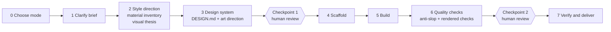

# fe-design

**A front-end design pipeline for Claude Code, tuned for Traditional Chinese decks and pages.**

`fe-design` turns a one-line brief into a slide deck, landing page, app screen or design system through seven stages. In an interactive session you confirm the output of every stage, and two of the confirmations are full review packages. When it is started from a chat channel (async mode), a stage that gets no reply within the timeout (5 minutes by default) moves on with the recommended choice; `--async-default` changes that, and three timeouts in a row pause the run. It ships with a Traditional Chinese anti-slop checker, a rendered-QA procedure for HTML slide decks, design-system starters, copy-paste scaffolds and export tools (standalone HTML, PDF, PPTX).

It grew out of day-to-day consulting work: it has been used to build dozens of corporate and training decks in Traditional Chinese. This repository is the shareable core of that toolkit.

[繁體中文說明](#繁體中文說明)

---

## Who it is for

- People who build slide decks or web pages **in Traditional Chinese** with Claude Code and keep running into the same problems: mixed serif and sans-serif Chinese fonts, simplified characters slipping in, mainland wording, slides that overflow on a projector, and pages that look like every other AI-generated page.
- Anyone who wants a design process with explicit checkpoints instead of "generate and hope".

It is less useful for dashboards and data-heavy back-office screens. The pipeline supports them (`app` mode), but the strongest parts of this toolkit are aimed at presentation work.

## What's inside

| Part | What it does |
|---|---|
| `commands/fe-design.md` | The `/fe-design` command: a seven-stage pipeline with five modes (`deck`, `page`, `app`, `system`, `migrate`), a confirmation after every stage with two full review packages (in async mode, unanswered stages time out and move on), and resumable state in `.checkpoints/`. |
| `commands/anti-slop.md` | The `/anti-slop` command: runs the checker below on a file or folder. |
| `skills/anti-slop-review/` | Anti-slop checker: 19 tropes written for Traditional Chinese, 7 hard blocks, and a structural lint of `DESIGN.md` through Google's design.md linter. 135 tests. |
| `skills/starter-components/` | Scaffolds (deck stage, device frames, charts, design canvas), 6 design-system starters, 4 Chinese–English font-pairing presets plus a consulting-deck token preset, craft rules, deck gates and export tools. |
| `skills/design-context-import/` | Extracts design tokens from an existing codebase (Tailwind, CSS variables, SCSS) into a `DESIGN.md`. |
| `tools/` | `check_public.py` and `verify.sh`: the repository's own test runner and leak checker. |

## Highlights

**Traditional Chinese anti-slop checks.** Most design checkers are written for English pages. These check things that go wrong in Traditional Chinese:

- mixing a Ming (serif) face with a Hei (sans-serif) face without intent (`/anti-slop`);
- generic AI page patterns, written up as 19 tropes with a "why it is slop" and a fix for each (`/anti-slop`);
- simplified characters, judged character by character (not Big5 *and* converted by OpenCC), with an exception list. This check lives in the deck gates and in `tools/check_public.py`, not in `/anti-slop`.

**Rendered QA for HTML slide decks.** Source scans cannot see what a projector shows, so stage 6 of `deck` mode runs four rendered gates, specified in [`references/rendered-qa.md`](skills/starter-components/references/rendered-qa.md) and carried out with Playwright: layout rhythm across a contact sheet, measured type size and overflow (at least 28 px for projected body text), a full screenshot review with a slop diagnostic, and a viewport-fit test at 1440×900 and 1280×800. Shipped tools support it: a visual diff between two deck versions, PDF and standalone-HTML export, a fact-check that locks names and numbers to their sources, and static deck gates for simplified characters, AI labels, signature rules and question-word headings (with negative test cases).

**A process with checkpoints.** Before any code, the pipeline asks for:

- a *client material inventory*: three to five things only this client or this course has, each with its source and the slide or motif it will feed;
- a *visual thesis*: a named concept, a metaphor, three motifs, an emotional curve and how the opening and closing echo each other;
- an *art-direction contract* and a slide plan.

A human approves these before implementation, and again after the quality checks.

## The pipeline



## Requirements

| Requirement | Used for |
|---|---|
| [Claude Code](https://docs.claude.com/en/docs/claude-code) | Runs the `/fe-design` and `/anti-slop` commands |
| Python 3.10+ and `pytest` | Anti-slop checker, deck gates, tests |
| [OpenCC](https://github.com/BYVoid/OpenCC) command-line tool (`opencc`; `brew install opencc` or `apt install opencc`) | Simplified-character checks |
| Node.js 20+ | Export tools and the design.md linter (the pinned Playwright needs Node 20) |
| [Playwright](https://playwright.dev) with Chromium | Rendered deck checks, PDF export, visual diff |
| [pptxgenjs](https://github.com/gitbrent/PptxGenJS) | Editable PPTX export (optional) |
| `pixelmatch` and `pngjs` | Visual diff between two deck versions (optional) |
| `ffmpeg` | Video export of a deck (optional) |

## Install

```bash
git clone https://github.com/NeriakTo/fe-design-skill.git
cd fe-design-skill

# Node dependencies and a browser for the rendered checks
npm install
npx playwright install chromium

# Link the commands and skills into Claude Code
mkdir -p ~/.claude/commands ~/.claude/skills
ln -s "$PWD/commands/fe-design.md" ~/.claude/commands/fe-design.md
ln -s "$PWD/commands/anti-slop.md" ~/.claude/commands/anti-slop.md
for s in anti-slop-review starter-components design-context-import; do
  ln -s "$PWD/skills/$s" ~/.claude/skills/$s
done
```

The command files refer to the skills under `~/.claude/skills/`, so link (or copy) them to exactly those paths. Restart Claude Code after linking.

Check the installation:

```bash
bash tools/verify.sh --allow-missing-terms
```

`--allow-missing-terms` skips the maintainer's private-term list, which is not part of this repository.

## Quick start

```text
/fe-design deck "Kick-off meeting for a factory automation project"
/fe-design page "Landing page for an evening course"
/anti-slop ./index.html
```

Or run the checker directly:

```bash
python3 skills/anti-slop-review/scan.py ./index.html
```

## What the anti-slop checker looks for

A few of the 19 tropes, with figures from a 2026 study of 248 award-gallery sites by the [taste-skill](https://github.com/Leonxlnx/taste-skill) project (model-judged; the figures show what tends to appear together, not cause and effect):

| Pattern | Seen on high-scoring sites | Seen on low-scoring sites |
|---|---|---|
| Icon-topped feature cards | 1% | 28% |
| Gradient fills | 22% | 52% |
| Shadows on resting elements | 24% | 48% |
| Tiny uppercase letter-spaced labels | 16% | 57% |

The checker deliberately does **not** flag monospace labels, slide numbering or thin rules: the same study found them as common or more common on high-scoring sites, and decks and data pages use them for good reasons.

The full catalogue, with a fix for each trope, is in [`skills/anti-slop-review/trope-catalog.md`](skills/anti-slop-review/trope-catalog.md).

## Optional companion skills

`fe-design` calls a few skills that are **not** part of this repository. If they are not installed, the pipeline skips the step that uses them.

- `design-review` and `design-consultation` from [gstack](https://github.com/garrytan/gstack): the interactive design review in stage 6, and the full design consultation in `system` mode.
- `frontend-design`, `frontend-patterns` and `frontend-slides`: implementation help in stage 5.
- `awesome-design-md`: reference designs in stage 2.
- `eli5` from [anthropics/claude-plugins-community](https://github.com/anthropics/claude-plugins-community): one-page plain-language explainers, an alternative to this pipeline for that job.
- A second model for adversarial review, and an image-generation tool for illustrations. Neither is required.

## Limitations

- Written for Traditional Chinese. Most rules still apply to English pages, but the font-pairing and wording checks assume Chinese text.
- Four structural tropes (03, 13, 15, 16) are not implemented as automated checks yet; the report lists them as "not checked" rather than passed.
- The rendered checks need Playwright and a local Chromium.
- The rendered gates are a procedure the agent follows with Playwright, not a single ready-made command; results depend on the agent actually running each gate.
- Deck signature and variant rules (for example, a required author line on the cover) live in `skills/starter-components/scripts/deck-gates.config.json` as `{"variants": {"<name>": {"required": [regex], "forbidden": [regex]}}}`. The default variants check no signatures.
- Built and tested with Claude Code. Other agents can read the files, but the commands assume Claude Code.

## A note on section numbers

The command and reference files cite section and item numbers such as `§19.2`, `§24.2` or `P10.1`. They point to the internal planning document the pipeline was built from, which is not part of this repository. They are kept so that rules can be traced back to their origin; every rule they label is written out in full where it is cited.

## Credits and license

Licensed under the [Apache License 2.0](LICENSE). Third-party material and its licences are listed in [NOTICE](NOTICE):

- [google-labs-code/design.md](https://github.com/google-labs-code/design.md) (Apache-2.0): the `DESIGN.md` format, the bundled linter and the starter the *chenxi-liuli* template is adapted from.
- [Leonxlnx/taste-skill](https://github.com/Leonxlnx/taste-skill) (MIT): the layout craft rules in `craft/taste-layout.md` and the study figures above.
- [VoltAgent/awesome-design-md](https://github.com/VoltAgent/awesome-design-md) (MIT): reference for the trope categories.
- [Inter](https://github.com/rsms/inter) (SIL Open Font License 1.1).

Author: Kevin Du ([@NeriakTo](https://github.com/NeriakTo)). Issues and pull requests are welcome; this is maintained in spare time, so replies may be slow.

---

## 繁體中文說明

**給 Claude Code 用的前端設計流程，專為繁體中文的簡報與網頁調校。**

`fe-design` 把一句話的需求，經過七個階段（互動模式下每階段都等你確認，其中兩次是完整的審查包；從聊天頻道啟動的 async 模式，逾時預設 5 分鐘沒回覆就照建議選項往下走，可用 `--async-default` 改，連續三次逾時會暫停），做成簡報、網頁、應用介面或設計系統。內含繁體中文的反樣板檢查、HTML 簡報的渲染後檢查、設計系統起步模板、可直接套用的骨架元件，以及匯出工具（單檔 HTML、PDF、PPTX）。

這套工具來自日常的顧問工作，已用在數十份企業與課程簡報上。這個倉庫是其中可以公開分享的核心版。

### 適合誰

- 用 Claude Code 做**繁體中文**簡報或網頁，常遇到這些問題的人：中文明體與黑體混用、混進簡體字或大陸用語、投影時文字溢出、做出來的頁面跟其他 AI 產的長得一樣。
- 想要有明確檢查點的設計流程，而不是「產出來再說」的人。

儀表板與資料密集的後台畫面也能用（`app` 模式），但這套工具最強的部分是簡報與展示型頁面。

### 內容

| 部分 | 用途 |
|---|---|
| `commands/fe-design.md` | `/fe-design` 指令：七階段流程、五種模式（`deck`、`page`、`app`、`system`、`migrate`）、每階段確認並有兩次完整審查包（async 模式逾時會自動往下走），中斷後可從 `.checkpoints/` 接續。 |
| `commands/anti-slop.md` | `/anti-slop` 指令：對檔案或資料夾跑反樣板檢查。 |
| `skills/anti-slop-review/` | 反樣板檢查器：19 條繁中寫法的樣板跡象、7 條硬擋，並用 Google 的 design.md 檢查器檢查 `DESIGN.md` 結構。135 項測試。 |
| `skills/starter-components/` | 骨架元件（簡報舞台、裝置外框、圖表、設計畫布）、6 套設計系統起步模板、4 套中英字體配對與 1 套顧問簡報參數、品質規則、簡報關卡與匯出工具。 |
| `skills/design-context-import/` | 從既有程式碼（Tailwind、CSS 變數、SCSS）抽出設計參數，產生 `DESIGN.md`。 |
| `tools/` | 倉庫自己的測試與外洩檢查：`check_public.py`、`verify.sh`。 |

### 特色

- **繁體中文反樣板檢查**：`/anti-slop` 偵測中文明體與黑體混搭，19 條樣板跡象各附「為什麼是樣板」與修正方法；簡體字逐字判斷（非 Big5 且 OpenCC 會轉換才算，附例外表）在簡報關卡與 `tools/check_public.py` 裡，不在 `/anti-slop`。
- **HTML 簡報渲染後檢查**：`deck` 模式第 6 階段依 [`references/rendered-qa.md`](skills/starter-components/references/rendered-qa.md) 用 Playwright 跑四道關卡：整份縮圖總覽的版面節奏、字級與溢出量測（投影內文至少 28px）、全部截圖人工評審加樣板診斷、1440×900 與 1280×800 視窗是否超出版面。附帶工具：兩版簡報的視覺差異比對、PDF 與單檔 HTML 匯出、把人名與數字鎖回來源的事實檢查，以及檢查簡體字、AI 標註、署名規則、標題疑問詞的靜態關卡（附反例測試）。
- **有檢查點的流程**：動工前先做客戶素材盤點（3 到 5 項這個客戶或這堂課才有的東西，寫出來源與用在哪一頁）、視覺主張（概念名、隱喻、三個母題、情緒曲線、首尾呼應）、美術合約與逐頁規劃；人工確認後才實作，品質檢核後再確認一次。

### 安裝

需求：Claude Code、Python 3.10 以上與 pytest、OpenCC 命令列工具（`brew install opencc` 或 `apt install opencc`）、Node.js 20 以上、Playwright（含 Chromium）；選用：pptxgenjs（可編輯 PPTX）、pixelmatch 與 pngjs（視覺差異比對）、ffmpeg（影片匯出）。

```bash
git clone https://github.com/NeriakTo/fe-design-skill.git
cd fe-design-skill
npm install
npx playwright install chromium

mkdir -p ~/.claude/commands ~/.claude/skills
ln -s "$PWD/commands/fe-design.md" ~/.claude/commands/fe-design.md
ln -s "$PWD/commands/anti-slop.md" ~/.claude/commands/anti-slop.md
for s in anti-slop-review starter-components design-context-import; do
  ln -s "$PWD/skills/$s" ~/.claude/skills/$s
done

bash tools/verify.sh --allow-missing-terms
```

指令檔以 `~/.claude/skills/` 的路徑引用技能，請連結（或複製）到這個位置；連結後重新啟動 Claude Code。

### 快速上手

```text
/fe-design deck "工廠自動化專案啟動會議"
/fe-design page "晚間課程招生頁"
/anti-slop ./index.html
```

### 限制

- 以繁體中文為主；多數規則也適用英文頁面，但字體配對與用語檢查假設內容是中文。
- 4 條結構型樣板（03、13、15、16）尚未做成自動檢查，報告會列為「未檢查」，不算通過。
- 渲染後檢查需要 Playwright 與本機 Chromium。
- 渲染後關卡是代理照著執行的工序，不是一支現成指令；結果取決於每道關卡是否真的執行。
- 簡報的署名與變體規則（例如封面必須出現作者名）寫在 `skills/starter-components/scripts/deck-gates.config.json`，預設的變體都不檢查署名。
- 在 Claude Code 上開發與測試；其他代理工具可以讀這些檔案，但指令以 Claude Code 為準。

### 關於章節編號

指令與參考文件裡的 `§19.2`、`§24.2`、`P10.1` 這類編號，指向這套流程原本的內部規劃書，規劃書不在本倉庫。保留編號是為了追溯規則出處；每條規則在引用處都已完整寫出。

### 授權

Apache License 2.0。第三方內容與授權見 [NOTICE](NOTICE)。作者 Kevin Du（[@NeriakTo](https://github.com/NeriakTo)）。歡迎回報問題與提交修改；個人利用空閒時間維護，回覆可能較慢。
